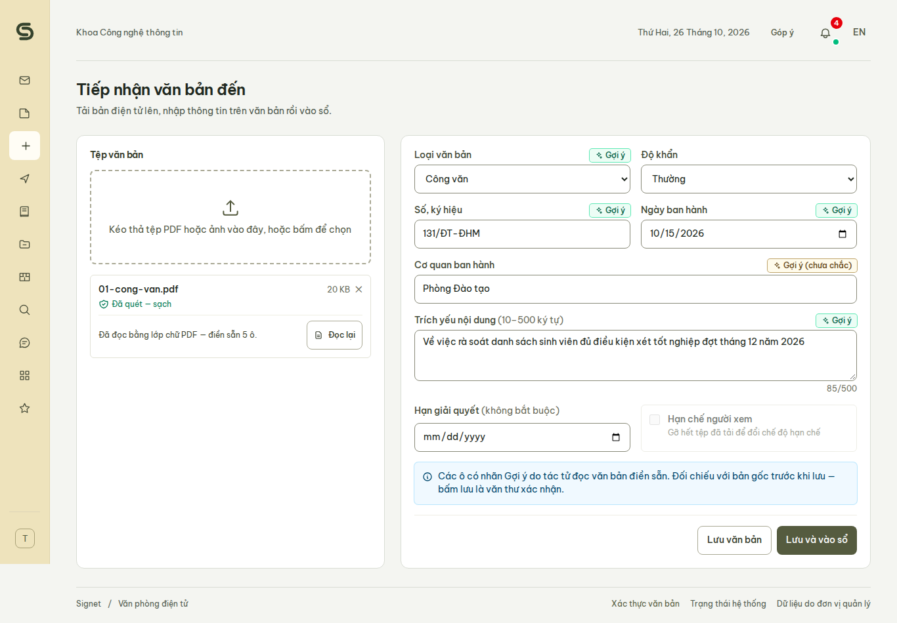
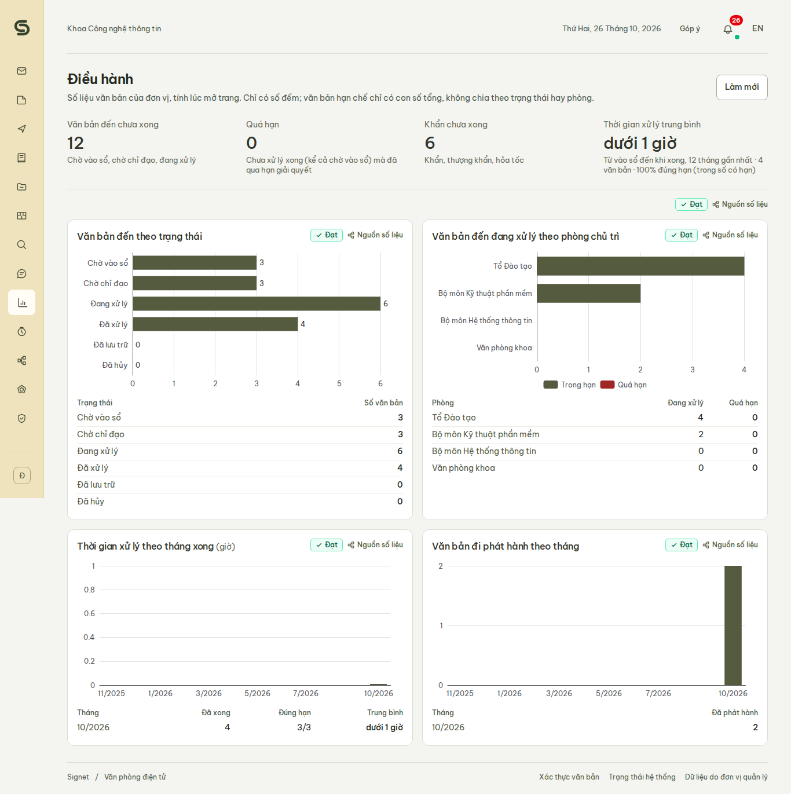
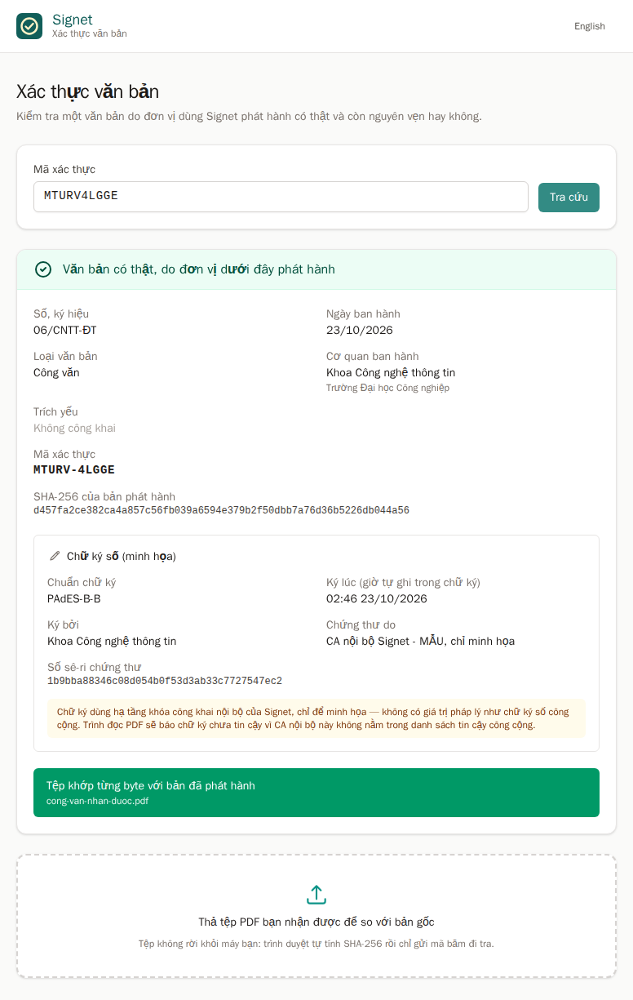

# Signet

**English:** [README.en.md](README.en.md)

> **Lõi nền tảng nguồn mở, tự cài, đóng dấu tin cậy lên mọi thứ đi qua nó** — kèm ứng dụng đầu tiên chạy trên lõi:
> **Văn phòng điện tử** quản lý văn bản đến, văn bản đi theo Nghị định 30/2020/NĐ-CP.

[](./LICENSE)
[](https://github.com/HIT-Champion/HVL/actions/workflows/ci.yml)
[](https://github.com/HIT-Champion/HVL/releases)

*Signet* là chiếc nhẫn ấn xưa dùng để đóng dấu lên thư từ, văn bản: nhìn dấu biết ai gửi, niêm còn nguyên biết chưa ai
mở hay sửa. Lõi Signet làm đúng việc đó cho dữ liệu số. Mọi thao tác biết ai đã làm, mọi tệp được quét mã độc trước
khi lưu, mọi thay đổi vào sổ kiểm toán không sửa lén được, và văn bản tổ chức phát hành ra ngoài thì người nhận tự
kiểm chứng được.

Sản phẩm dự thi **Olympic Tin học Sinh viên Việt Nam 2026 — nội dung Phần mềm Nguồn mở (OLP PMNM 2026)**, chủ đề
DX-OS Open-Core.

**Đọc nhanh:** [Bài toán](#bài-toán) · [Tính năng](#tính-năng) · [Bằng chứng 4 nguyên lý](#bằng-chứng-4-nguyên-lý) ·
[Kiến trúc](#kiến-trúc) · [Cài đặt](#cài-đặt-từ-mã-nguồn-building-from-source) · [Vận hành](#vận-hành) ·
[Kiểm thử](#kiểm-thử) · [Tài liệu](#tài-liệu)

---

## Bài toán

Hơn 900.000 doanh nghiệp nhỏ và vừa cùng các trường, khoa, cơ quan nhà nước cấp cơ sở đang chuyển đổi số theo một
trong hai cách, và cả hai đều vướng:

- **Mua nhiều phần mềm rời rạc**: mỗi phần mềm một tài khoản, một kho dữ liệu, một quy trình. Dữ liệu có nhưng không
  chảy được giữa các bộ phận: **ốc đảo dữ liệu**.
- **Mua một hệ thống nguyên khối**: cồng kềnh, khó nâng cấp; tổ chức thành "con tin" của một nhà cung cấp và mất
  **chủ quyền số**.

Đằng nào thì mỗi ứng dụng mới cũng dựng lại từ đầu phần đăng nhập, lưu tệp, phân quyền, quy trình duyệt — và tự lo
phần tin cậy, mà thường là không lo.

Signet tách phần dùng chung đó thành một **lõi chạy ngầm, không giao diện**, lắp hoàn toàn từ phần mềm nguồn mở để
tổ chức tự cài, tự làm chủ. Ứng dụng mới chỉ cần cắm vào lõi; thay ứng dụng ở tầng trên không phải động đến lõi.

### Bốn con dấu của lõi

Điểm riêng của Signet là một lớp **tin cậy** dùng chung. Ứng dụng nào cắm vào cũng có sẵn, không phải tự làm:

| Con dấu | Nghĩa là | Thành phần | Cụm Tầng 1 |
|---|---|---|---|
| Biết ai đã làm | Mọi lời gọi mang danh tính SSO, kể cả của tác tử AI; vai trò quan trọng bắt buộc xác thực hai bước | Keycloak, APISIX | ① ② |
| Sạch | Tệp được quét mã độc trước khi lưu, tệp bẩn không chạm tới kho | `svc-files` + ClamAV | ① |
| Không sửa lén được | Mọi thay đổi vào sổ kiểm toán chuỗi băm; mốc đầu chuỗi neo ra ngoài CSDL, sửa lén thì `make audit` chỉ ra dòng bị sửa | PostgreSQL, schema `core` | ⑥ |
| Kiểm chứng được từ bên ngoài | Văn bản phát hành mang mã QR, SHA-256 và chữ ký số (minh họa, không có giá trị pháp lý); cổng xác thực công khai, không cần đăng nhập | `svc-files`, route `/api/verify` | ④ ⑥ |

## Tính năng

### Văn phòng điện tử

Ở khoa, trường và các cơ quan nhỏ, công văn vẫn đến bằng giấy hoặc bản scan gửi qua email, Zalo; văn thư ghi sổ tay
hoặc Excel; lãnh đạo bút phê trên giấy. Phần mềm quản lý văn bản phổ biến lại là sản phẩm đóng, giữ dữ liệu của cơ
quan trong hệ thống của nhà cung cấp. Trên Signet, một công văn đi trọn vòng đời **tiếp nhận → vào sổ → chỉ đạo → xử
lý → trả lời → phát hành → lưu trữ** theo Nghị định 30/2020/NĐ-CP về công tác văn thư:

| Vấn đề hiện nay | Signet xử lý bằng | Không gian |
|---|---|---|
| Văn bản thất lạc, không biết đang nằm ở bàn ai | Vào sổ, luồng xử lý BPMN, hộp việc của đúng người, thông báo tức thời | [P] |
| Quá hạn giải quyết mà không ai nhắc | Hạn theo từng việc được giao, tự nhắc rồi báo lãnh đạo; văn bản khẩn lên đầu | [P] |
| Nhập sai, vào sổ trùng | Chặn nhập sai ở cả form, máy chủ và CSDL theo một JSON Schema dùng chung (Poka-yoke); chặn vào sổ trùng | [P] |
| Văn thư gõ lại từng công văn đến | Tác tử đọc lớp chữ PDF hoặc nhận dạng chữ bản scan, gợi ý sẵn số ký hiệu, ngày, cơ quan, trích yếu | [I] |
| Tệp đính kèm có thể chứa mã độc | Quét virus trước khi lưu | Lõi |
| Không kiểm được văn bản nhận được là thật | Mã QR, SHA-256, chữ ký số PAdES (minh họa); cổng xác thực công khai, ai cũng kiểm được | Lõi + [D] |
| Đơn vị gửi văn bản cho nhau qua email | Liên thông trên cùng bản cài: bên nhận có ngay văn bản đến, tệp trùng từng byte, kèm mã xác thực | [P] |
| Hồ sơ bị sửa lén sau khi lưu | Sổ kiểm toán chuỗi băm; nộp lưu hồ sơ sang kho lạnh khóa ghi, có băm | Lõi + [D] |
| Văn bản nhạy cảm bị lộ | Mã hóa từng tệp, chỉ giải mã trong bộ nhớ cho người có tên; bản mở đóng tên người xem lên mọi trang | [P] |
| Lãnh đạo không biết việc nghẽn ở đâu | Dashboard điều hành từ số liệu thật | [D] |
| Tìm lại văn bản cũ mất thời gian | Tìm toàn văn, cả chữ trong tệp PDF đính kèm; trợ lý hỏi đáp trả lời kèm số ký hiệu và trang | [I] |

Ngoài ra: sổ đăng ký văn bản đến, đi đúng mẫu NĐ 30, in ra PDF để ký nhận và đóng sổ; nhiều đơn vị trên một bản cài,
mỗi người chỉ thấy dữ liệu của đơn vị mình; giao diện tiếng Việt và tiếng Anh. Chi tiết phạm vi, vai trò người dùng:
[`docs/dac-ta-san-pham.md`](docs/dac-ta-san-pham.md).

Bài toán đi đúng lộ trình `[H] → [P] → [D] → [I]` của mô hình DX-OS: có danh tính số mới chuẩn hóa được quy trình,
quy trình chuẩn mới sinh ra số liệu sạch, có số liệu sạch thì AI mới gợi ý đúng.

### Trợ lý AI chạy tại chỗ

AI trong Signet chỉ **gợi ý**, người quyết định; mọi thứ chạy trên máy chủ của tổ chức, không gửi dữ liệu ra ngoài.

- **Đọc văn bản đến**: văn thư tải công văn lên là tác tử đọc lớp chữ PDF, hoặc nhận dạng chữ (Tesseract tiếng Việt)
  nếu là ảnh chụp, bản scan, rồi gợi ý sáu ô của form tiếp nhận kèm độ tin cậy. Số và ngày luôn do quy tắc theo thể
  thức NĐ 30 quyết, không bao giờ do mô hình. Trên 22 văn bản mẫu: số ký hiệu đúng 20/22, ngày ban hành đúng 22/22.
- **Hỏi đáp trên kho văn bản**: hỏi bằng câu thường ngày, nhận câu trích nguyên văn kèm nguồn "số ký hiệu · tr. n".
  Trợ lý chỉ tìm trong văn bản người hỏi được xem; văn bản hạn chế không bao giờ vào chỉ mục.
- **Gợi ý giao việc**: văn bản vừa vào sổ thì tác tử gợi ý đơn vị chủ trì và hạn xử lý, kèm các văn bản tương tự đã
  giao làm căn cứ. Gợi ý chạy song song, không chắn việc của lãnh đạo.
- **Che thông tin cá nhân**: số CCCD, điện thoại, email, tài khoản ngân hàng bị che trước khi tới mô hình và nhật ký;
  người có quyền đọc văn bản vẫn thấy số thật.

Cả bốn chạy được **không cần mô hình ngôn ngữ** (quy tắc, OCR, tìm kiếm toàn văn), nên CI, máy yếu, máy không có
Internet đều chạy. Bật mô hình cục bộ (Ollama với Qwen3 1,7B và Qwen3-Embedding 0,6B, chạy trên CPU) để viết trích
yếu, tìm theo nghĩa và viết câu trả lời: `make ai-model` (tải mô hình một lần) rồi `make up-ai`. Cách làm và số đo
đầy đủ: [`services/svc-files/README.md`](services/svc-files/README.md).

### Ảnh chụp màn hình

Chụp tự động trong lượt e2e (`make e2e`), dữ liệu mẫu hư cấu. Giao diện mặc định tiếng Việt, trang nào cũng có bản
tiếng Anh.

| Văn thư tải công văn lên, tác tử điền sẵn các ô | Lãnh đạo xem việc nghẽn ở đâu | Người nhận tự kiểm văn bản, không cần đăng nhập |
|---|---|---|
| [](docs/anh/doc-van-ban-goi-y.png) | [](docs/anh/dieu-hanh.png) | [](docs/anh/xac-thuc.png) |

## Bằng chứng 4 nguyên lý

Đề thi yêu cầu sản phẩm dựng trên 4 nguyên lý thiết kế. Mỗi nguyên lý có màn demo chạy bằng **một lệnh**, dưới một
phút, in từng bước kèm ✓, chạy lại bao nhiêu lần cũng được — kịch bản trình bày ở
[`docs/demo-script.md`](docs/demo-script.md).

| Nguyên lý | Màn demo | Lệnh |
|---|---|---|
| (i) Vòng đời và tốc độ dữ liệu | Hồ sơ đã đóng nộp lưu thành gói Parquet + tệp + manifest có băm trên kho lạnh khóa ghi; vẫn tìm thấy, quét mã QR vẫn "khớp" | `make demo-nong-lanh` |
| (ii) Hội tụ IT/OT | Cảm biến nhiệt độ → NGSI-LD (Scorpio) → vượt ngưỡng thì dựng dự thảo "Báo cáo sự cố" vào luồng văn bản đi | `make demo-it-ot` |
| (iii) Quản trị dữ liệu | Phả hệ OpenLineage: gói lưu trữ truy ngược về bảng nghiệp vụ và tệp gốc; kiểm số dòng, cột bắt buộc trước khi ghi | `make demo-pha-he` |
| (iv) Zero-Trust | Kiểm dịch: tệp EICAR bị chặn ở cửa ngõ, lần chặn vào sổ kiểm toán | `make demo-kiem-dich` |
| (iv) Zero-Trust | Văn bản hạn chế: tệp mã hóa trong kho, chỉ người có tên mở được, bản mở có dấu tên | `make demo-han-che` |
| (iv) Zero-Trust | Két bí mật: dịch vụ không giữ bí mật, két tự mở khóa khi khởi động lại | `make demo-ket-bi-mat` |
| (iv) GitOps | Tự phục hồi: xóa container, reconciler dựng lại theo khai báo trong git | `make demo-tu-phuc-hoi` |

Các màn nghiệp vụ, cùng cách chạy: `make demo-lien-thong` (liên thông hai đơn vị), `make demo-doc-van-ban`,
`make demo-hoi-dap`, `make demo-giao-viec`, `make demo-che-pii` (trợ lý AI), `make demo-ky-so` (ký số, minh họa).

## Kiến trúc

Tầng 1 là lõi — định danh, cổng API, dữ liệu, quy trình và lớp tin cậy — không có giao diện. Tầng 2 là ứng dụng, ở
đây là Văn phòng điện tử. Chỉ cổng APISIX mở ra ngoài.

```
 Trình duyệt ──► APISIX :8080 ─┬─ /             → app-office (Nuxt, trang tĩnh; /xac-thuc công khai)  Tầng 2
                (kiểm JWT,     ├─ /realms/moc/*  → Keycloak (đăng nhập SSO, TOTP)
                 X-Request-Id) ├─ /v1/graphql    → Hasura ─┬─ PostgreSQL (core, office)               Tầng 1
                               │                           └─ Actions → svc-workflow → Flowable (BPMN)
                               ├─ /api/files, /api/search, /api/documents/*, /api/registers/* → svc-files
                               ├─ /api/verify (không token, giới hạn theo IP) → svc-files
                               │  svc-files: ClamAV · SeaweedFS · Meilisearch · dựng PDF · Ollama (tùy chọn)
                               └─ /realtime (WebSocket) → Centrifugo ◄── svc-workflow đẩy thông báo
```

| Thành phần | Vai trò | Thư mục |
|---|---|---|
| Keycloak 26 | SSO, TOTP; vai trò, đơn vị, phòng đưa vào token cho Hasura | `auth/realm/` |
| Apache APISIX 3 | Cổng duy nhất mở ra ngoài: danh sách trắng đường dẫn, kiểm JWT ở biên, chặn đường quản trị, giới hạn tốc độ đăng nhập (theo IP) và API (theo phiên) | `gateway/` |
| Hasura 2 + PostgreSQL 16 | GraphQL tự sinh, quyền theo vai trò và đơn vị đến từng dòng, sổ kiểm toán chuỗi băm | `db/` |
| Flowable 8 | Quy trình BPMN xử lý văn bản đến, duyệt và phát hành văn bản đi | `processes/` |
| `svc-workflow` | Hasura Actions: vào sổ, trình văn bản đi, hộp việc, hoàn thành việc, phát hành; thông báo, nhắc hạn; đồng bộ danh bạ Keycloak; nhận cảnh báo cảm biến | `services/svc-workflow/` |
| `svc-files` | Tải tệp qua ClamAV vào SeaweedFS, tìm kiếm Meilisearch; dựng PDF văn bản đi có mã QR, ký số PAdES (minh họa), in sổ; cổng xác thực; các tác tử AI | `services/svc-files/` |
| Centrifugo 6 | Đẩy thông báo tới trình duyệt qua WebSocket, kênh riêng từng người | `realtime/` |
| OpenBao 2 | Két bí mật: dịch vụ lấy bí mật qua AppRole lúc khởi động; khóa mã hóa văn bản hạn chế; CA nội bộ và khóa ký của từng đơn vị | `openbao/` |
| `app-office` | Giao diện Văn phòng điện tử (Nuxt 4, Tailwind), tiếng Việt / tiếng Anh | `apps/office/` |
| Prometheus 3 + Grafana 13 | Giám sát cổng API: số yêu cầu, mã trạng thái, độ trễ theo route; chỉ trong mạng nội bộ | `monitoring/` |
| Scorpio 6 + PostGIS (profile `iot`) | Context broker NGSI-LD: bản sao số của cảm biến, lịch sử đo | `ot/` |
| Ollama (profile `ai`, tùy chọn) | Mô hình ngôn ngữ cục bộ, mạng nội bộ riêng, tắt tính năng đám mây | `docker-compose.yml` |

Mô hình H-P-D-I, bản đồ công cụ và các quyết định kỹ thuật: [`docs/architecture.md`](docs/architecture.md). Mô hình
dữ liệu và quyền: [`docs/mo-hinh-du-lieu.md`](docs/mo-hinh-du-lieu.md).

> Signet trước đây tên **Mộc**. Tên mã kỹ thuật `moc` vẫn giữ trong mã và cấu hình: biến `MOC_*`, realm `moc`, lệnh
> `scripts/moc.py`, image `moc/*`, thư mục cài `/opt/moc`.

## Cấu trúc thư mục

Mã đội tự viết nằm ở `apps/`, `services/` và `db/`. Các thư mục cấu hình ở gốc (`auth/`, `gateway/`…) là cấu hình
của phần mềm nguồn mở mà lõi dùng, theo bảng ở mục Kiến trúc.

```
apps/office/             Giao diện Văn phòng điện tử (Nuxt 4, TypeScript): app/pages, app/components…; tests/
services/
  svc-workflow/          Hasura Actions, quy trình, thông báo, nhắc hạn (Python, FastAPI); tests/
    src/svc_workflow/    advisor.py + suggest.py: tác tử gợi ý giao việc (F4.3); ot.py: cảm biến → báo cáo sự cố
  svc-files/             Tệp, kiểm dịch, tìm kiếm, dựng PDF, ký số, cổng xác thực (Python, FastAPI); tests/
    src/svc_files/       docread/: đọc văn bản đến (F4.1) · assist/: hỏi đáp trên kho văn bản (F4.2) ·
                         pii.py: che thông tin cá nhân (F4.4)
db/
  migrations/default/    Lược đồ PostgreSQL (core, office), ràng buộc, sổ kiểm toán chuỗi băm
  metadata/              Hasura: quyền theo vai trò và đơn vị, Actions
  tests/                 Test trên PostgreSQL + Hasura thật
schemas/                 JSON Schema của form, dùng chung cho giao diện, dịch vụ và CSDL
processes/               Quy trình BPMN văn bản đến, văn bản đi; svc-workflow nạp vào Flowable
auth/ gateway/ realtime/ Cấu hình Keycloak, APISIX, Centrifugo
openbao/ monitoring/     Cấu hình OpenBao; Prometheus + Grafana
ot/                      Cảm biến giả lập (profile iot)
ops/systemd/             Hẹn giờ chạy reconciler GitOps trên máy chủ
scripts/                 Lệnh vận hành (moc.py, seed, smoke, backup, audit, reconcile, demo), cài đặt (install.sh),
                         công cụ của repo (check_pr.py, release*, license-header.sh, api_docs.py); tests/
seed/                    Dữ liệu mẫu: đơn vị, tài khoản, văn bản giả lập để demo và đo các tác tử AI
tests/e2e/               Test trình duyệt (Playwright)
docs/                    Tài liệu sản phẩm: kiến trúc, mô hình dữ liệu, triển khai, vận hành; api/: tài liệu API
docs/du-thi/             Tài liệu dự thi: phân tích đề, bảng tự chấm PoF, kế hoạch phát triển, nghiên cứu
.github/                 CI, phát hành, kiểm PR, ruleset, mẫu issue và PR
docker-compose.yml       Toàn hệ thống, chia profile core, app, ai, iot…
Makefile                 Lối vào mọi lệnh: make env, up, seed, test, smoke, install…
```

## Yêu cầu hệ thống

| Thành phần | Phiên bản tối thiểu | Ghi chú |
|---|---|---|
| Docker Engine | 24.0 | kèm plugin `docker compose` v2 từ 2.17 và `docker buildx` |
| GNU Make | 4.0 | điều phối lệnh |
| Python | 3.10 | chỉ thư viện chuẩn, không cài thêm gì: dữ liệu mẫu, smoke, demo, sao lưu, cài đặt và các lệnh vận hành |
| RAM | 8 GB | cả hệ thống (profile mặc định, 15 container) đo được khoảng 3,2 GB khi chạy (ClamAV 0,8 GB, Keycloak 0,6 GB, APISIX và Flowable mỗi dịch vụ 0,35 GB, Grafana 0,3 GB); bật mô hình AI cần thêm tới 6 GB |
| Đĩa trống | 10 GB | image khoảng 5 GB; mô hình AI thêm khoảng 2 GB |

Toàn bộ công cụ dùng để dựng Signet đều là phần mềm nguồn mở. Không cần bất kỳ công cụ nguồn đóng hay tự chế nào.

## Cài đặt từ mã nguồn (Building From Source)

```bash
# 1. Lấy mã nguồn
git clone https://github.com/HIT-Champion/HVL.git
cd HVL

# 2. Cấu hình (KHÔNG sửa mã nguồn để cấu hình — mọi tham số nằm trong .env)
make env              # sinh .env từ .env.example, mật khẩu ngẫu nhiên; hoặc: cp .env.example .env rồi sửa
make check

# 3. Dựng image của đội và khởi động toàn bộ (lần đầu vài phút: tải image, ClamAV nạp chữ ký)
make up

# 4. Nạp dữ liệu mẫu: 2 đơn vị, phòng ban, 10 tài khoản, văn bản ở mọi bước của quy trình
make seed
```

Mở <http://localhost:8080> và đăng nhập bằng một tài khoản mẫu; mật khẩu chung là giá trị `MOC_DEMO_PASSWORD` trong
`.env`. Văn thư, lãnh đạo, tổ trưởng, trưởng bộ môn và quản trị đơn vị bắt buộc xác thực hai bước: sau mật khẩu nhập
mã TOTP. `make seed` cài sẵn cho các tài khoản này một khóa chung (`MOC_DEMO_TOTP_SECRET`); `make totp` in mã hiện
tại và khóa để thêm một lần vào ứng dụng xác thực trên điện thoại (FreeOTP, Aegis, Google Authenticator). Tài khoản
thật thuộc các vai trò này tự cài TOTP bằng mã QR ở lần đăng nhập đầu.

| Tài khoản | Vai trò | Thấy gì |
|---|---|---|
| `vanthu` | Văn thư Khoa CNTT | Tiếp nhận, vào sổ; cấp số, phát hành văn bản đi; mọi văn bản của khoa |
| `truongkhoa` | Lãnh đạo khoa | Hộp việc chỉ đạo, ký duyệt văn bản đi; dashboard điều hành; mọi văn bản của khoa |
| `totruongdt`, `truongbmktpm` | Tổ trưởng Đào tạo, trưởng Bộ môn KTPM | Văn bản giao cho tổ, bộ môn; phân công; duyệt dự thảo |
| `chuyenviendt`, `giamkhao`, `giangvienktpm` | Chuyên viên, giảng viên | Văn bản được giao cho mình; soạn, trình văn bản đi |
| `quantri` | Quản trị đơn vị | Sổ kiểm toán của khoa; không đọc nội dung văn bản |
| `vanthukt`, `truongkhoakt` | Khoa Kinh tế | Chỉ văn bản của Khoa Kinh tế |

Ban giám khảo thử nhanh bằng `giamkhao` (chuyên viên, không cần TOTP): hộp việc có sẵn một công văn khẩn chờ xử lý
và một dự thảo phúc đáp bị tổ trưởng trả lại chờ sửa. Cổng xác thực văn bản không cần đăng nhập:
<http://localhost:8080/xac-thuc>; mã của các văn bản mẫu đã phát hành có trên trang chi tiết văn bản (mục Văn bản đi,
tab Đã phát hành).

Dừng: `make down` (giữ dữ liệu) · xóa sạch dữ liệu: `make reset` · xem mọi lệnh: `make help`.
Trang quản trị Keycloak chỉ mở trên máy chủ: <http://127.0.0.1:8180/admin> (tài khoản `KEYCLOAK_ADMIN_*`).

### Cài ra ngoài thư mục mã nguồn

`make install` dựng image của đội gắn thẻ phiên bản, chép `docker-compose.yml`, `.env` và các tệp cấu hình mà
container dùng sang `PREFIX`, rồi kiểm tra bản cài không còn trỏ về thư mục mã nguồn. Sau đó xóa thư mục mã nguồn đi
hệ thống vẫn chạy.

```bash
sudo install -d -o "$USER" /opt/moc     # thư mục cài thuộc người vận hành, không cần chạy make bằng root
make install PREFIX=/opt/moc
make down                               # nếu đang chạy trong thư mục mã nguồn: hai bản dùng chung dữ liệu
cd /opt/moc && docker compose up -d --wait
python3 scripts/seed.py                 # dữ liệu mẫu, lần đầu
```

- `PREFIX` mặc định là `/opt/moc`. Phiên bản lấy từ `git describe`; cài từ gói `.tar.gz` thì đặt tay:
  `make install PREFIX=/opt/moc MOC_VERSION=0.1.0`.
- Nâng cấp: dừng bản cài, `make install` lại với cùng `PREFIX`. Compose, cấu hình và image được thay; `.env` của bản
  cài được giữ, chỉ đổi `MOC_VERSION`.
- Gỡ: `make uninstall PREFIX=/opt/moc` xóa đúng các tệp đã cài, giữ `.env` và dữ liệu.
- Lên máy chủ có tên miền và HTTPS: [`docs/trien-khai.md`](docs/trien-khai.md) — Caddy trước APISIX,
  `MOC_HTTP_PORT=127.0.0.1:8080`, `MOC_TRUSTED_PROXY` để APISIX tin tiêu đề `X-Forwarded-*` của Caddy. Máy không có IP
  công khai (laptop, máy ở nhà): Cloudflare Tunnel, profile `tunnel` (mục 5b), không mở cổng nào.

## Vận hành

Các việc của người quản trị trên bản cài đang chạy nằm ở [`docs/van-hanh.md`](docs/van-hanh.md):

| Việc | Lệnh chính |
|---|---|
| [Thêm đơn vị](docs/van-hanh.md#thêm-đơn-vị-thuê-ước) (khoa, phòng, trường thành viên) | `python3 scripts/moc.py tenant create …` |
| [Sao lưu và khôi phục](docs/van-hanh.md#sao-lưu-và-khôi-phục) mọi CSDL, tệp, két vào kho restic mã hóa | `make backup`, `make restore` |
| [Két bí mật](docs/van-hanh.md#két-bí-mật) OpenBao: giới hạn, nâng cấp két cũ để ký số | `make demo-ket-bi-mat` |
| [GitOps và tự phục hồi](docs/van-hanh.md#gitops-và-tự-phục-hồi): systemd timer, chỉ áp commit đã ký | `make reconcile` |
| [Giám sát](docs/van-hanh.md#giám-sát) cổng API bằng Prometheus + Grafana | đường hầm SSH tới cổng 3300 |
| [Hội tụ IT/OT](docs/van-hanh.md#hội-tụ-itot): broker NGSI-LD, cảm biến | `make demo-it-ot` |
| [Kiểm sổ kiểm toán](db/README.md) ngoài CSDL | `make audit` |

## Kiểm thử

| Lệnh | Kiểm gì | Cần |
|---|---|---|
| `make test` | Test đơn vị của `svc-files`, `svc-workflow`, lệnh vận hành; kiểm form theo `schemas/` trên cùng bộ ca thử với máy chủ và CSDL | Python + [uv](https://github.com/astral-sh/uv); Node 24 và `npm ci` trong `apps/office` |
| `make smoke` | Đi trọn luồng văn bản đến, văn bản đi qua cổng APISIX; cổng xác thực, thông báo WebSocket, sổ kiểm toán; chặn dữ liệu sai, EICAR, đường quản trị; cách ly đơn vị; giới hạn tốc độ; két bí mật; reconciler; nộp lưu; giám sát | Hệ thống đang chạy + `make seed` |
| `make e2e` | Trình duyệt thật (Playwright, trong container): form sai bị chặn trước khi gửi, thả tệp vào trang xác thực, hai người dùng cùng lúc nhận thông báo, sổ kiểm toán, dashboard, ký số | Như trên |
| `make demo-*` | Các màn demo ở trên; sai bước nào thì dừng và thoát 1 | Như trên |
| `make audit` | Tính lại sổ kiểm toán chuỗi băm ngoài CSDL, so với mốc đã neo ra kho lạnh và hash của văn bản đã phát hành | Hệ thống đang chạy |
| `make do-doc-van-ban`, `do-hoi-dap`, `do-giao-viec`, `do-che-pii` | Đo các tác tử AI trên bộ mẫu có đáp án: đúng / sai / trống từng trường, recall@3, độ phủ | Hệ thống đang chạy (`do-che-pii` không cần) |
| `db/tests/` | Schema, quyền theo vai trò và đơn vị, ràng buộc, sổ kiểm toán (kể cả các kiểu sửa lén) trên PostgreSQL + Hasura thật | xem [`db/README.md`](db/README.md) |

Nhắc hạn chỉ kiểm được khi thời hạn mỗi bước ngắn (thật là `PT24H`): `MOC_SLA_DURATION=PT20S make up` rồi
`MOC_SLA_DURATION=PT20S make smoke`.

CI ([`.github/workflows/ci.yml`](.github/workflows/ci.yml)) chạy toàn bộ bảng trên cho mọi pull request: dựng hệ thống
từ mã nguồn bằng đúng các lệnh `make env` → `make up` → `make seed` → `make smoke` → `make e2e` → 12 màn demo (màn
kiểm dịch đã nằm trong smoke); diễn tập sao lưu, xóa dữ liệu, khôi phục rồi smoke lại; `make install` sang thư mục
khác và smoke lại từ bản cài; GitOps với repo git cục bộ; kiểm tài liệu API trong `docs/api/` khớp hệ thống vừa dựng;
quét bí mật trong lịch sử commit (gitleaks) và lỗ hổng đã biết trong các tệp khóa phụ thuộc (OSV-Scanner).

## Tài liệu

| Tài liệu | Nội dung |
|---|---|
| [`docs/demo-script.md`](docs/demo-script.md) | Kịch bản demo: 4 nguyên lý và các màn nghiệp vụ, mỗi màn một lệnh |
| [`docs/van-hanh.md`](docs/van-hanh.md) | Vận hành: thêm đơn vị, sao lưu, két bí mật, GitOps, giám sát, IT/OT |
| [`docs/trien-khai.md`](docs/trien-khai.md) | Triển khai lên máy chủ: HTTPS bằng Caddy trước APISIX, người vận hành, tường lửa, sao lưu hằng đêm, nâng cấp |
| [`docs/api/`](docs/api/README.md) | Tài liệu API: lấy token, gọi GraphQL và REST qua cổng; schema GraphQL theo vai trò và OpenAPI xuất tự động |
| [`docs/architecture.md`](docs/architecture.md) | Kiến trúc H-P-D-I, bản đồ công cụ, quyết định kỹ thuật |
| [`docs/mo-hinh-du-lieu.md`](docs/mo-hinh-du-lieu.md) | Mô hình dữ liệu, quyền, Hasura Actions, định dạng sự kiện |
| [`docs/dac-ta-san-pham.md`](docs/dac-ta-san-pham.md) | Đặc tả sản phẩm: bài toán, người dùng, chức năng |
| [`docs/du-thi/ke-hoach-phat-trien.md`](docs/du-thi/ke-hoach-phat-trien.md) | Kế hoạch phát triển theo phase, phân công, rủi ro |
| [`docs/git_flow.md`](docs/git_flow.md) | Quy trình Git: nhánh, commit, pull request, phát hành |
| [`docs/du-thi/pof-checklist.md`](docs/du-thi/pof-checklist.md) | Bảng tự chấm 50 điểm PoF |
| [`docs/du-thi/olp-2026-brief.md`](docs/du-thi/olp-2026-brief.md), [`docs/du-thi/olp-2026-de-thi.md`](docs/du-thi/olp-2026-de-thi.md) | Chủ đề DX-OS, thể lệ, tiêu chí chấm; phân tích đề thi chính thức |
| [`docs/du-thi/nghien-cuu/`](docs/du-thi/nghien-cuu/) | Nghiên cứu trước khi có đề thi (lưu trữ) |
| [`DEPENDENCIES.md`](DEPENDENCIES.md) | Danh mục phần mềm thượng nguồn, phiên bản ghim, giấy phép |
| [`CHANGELOG.md`](CHANGELOG.md) | Lịch sử thay đổi |
| [`CONTRIBUTING.md`](CONTRIBUTING.md) | Hướng dẫn đóng góp |
| [`ROADMAP.md`](ROADMAP.md) | Lộ trình phát triển |

## Báo lỗi và đóng góp

- **Báo lỗi / đề xuất tính năng**: mở issue tại <https://github.com/HIT-Champion/HVL/issues>
- **Đóng góp mã nguồn**: đọc [`CONTRIBUTING.md`](CONTRIBUTING.md) trước khi mở pull request
- **Quy tắc ứng xử**: [`CODE_OF_CONDUCT.md`](CODE_OF_CONDUCT.md)

## Giấy phép

Phát hành theo **Apache License 2.0** — một giấy phép được OSI phê duyệt. Toàn văn: [`LICENSE`](LICENSE). Mục đích
lựa chọn giấy phép: [`NOTICE`](NOTICE).

Mọi tệp đều có thông tin bản quyền và giấy phép theo chuẩn [REUSE](https://reuse.software): tệp mã mang header
Apache-2.0 (`make license-check`), tệp không chèn được header (JSON, ảnh, PDF, tài liệu) khai trong
[`REUSE.toml`](REUSE.toml). Kiểm toàn bộ kho: `uvx --from reuse==5.0.2 reuse lint`.

Signet **điều phối** các phần mềm nguồn mở thượng nguồn ở dạng nguyên bản, không sao chép và không chỉnh sửa mã nguồn
của chúng vào kho này. Xem [`DEPENDENCIES.md`](DEPENDENCIES.md).

---

## English summary

Small organisations digitalise by buying more software, but each tool becomes a data silo or locks them into a single
vendor. **Signet** — named after the signet ring once used to seal official letters — is a self-hosted, open-source
core platform: identity and SSO, an API gateway, structured and unstructured data, and a workflow engine that every
application can build on, assembled from upstream open-source components under an Open-Core architecture. The core
puts its seal on everything that passes through it: every call carries an identity, every file is scanned for malware
before it is stored, every change goes into a hash-chained audit log, and whatever the organisation issues can be
verified by outsiders through a public portal.

The first application on the core is an e-Office that manages incoming and outgoing official documents under
Vietnam's Decree 30/2020 on clerical work: a letter is received, registered, assigned, handled, answered, issued and
archived without getting lost, missing its deadline unnoticed or being silently altered. Issued documents carry a QR
code, a SHA-256 hash and an illustrative PAdES signature from an internal CA (no legal validity). Local AI assistants
read incoming letters, answer questions with quoted sources, and suggest assignments — always as suggestions, running
on the organisation's own server, with personal data masked before it reaches a model.

Built for the Vietnam Student Olympiad in Informatics 2026, Open Source Software track. Formerly named *Mộc*; the
technical codename `moc` remains in code and configuration. Licensed under Apache-2.0. Contributions welcome — see
`CONTRIBUTING.md`. Full English version of this page: [README.en.md](README.en.md).
