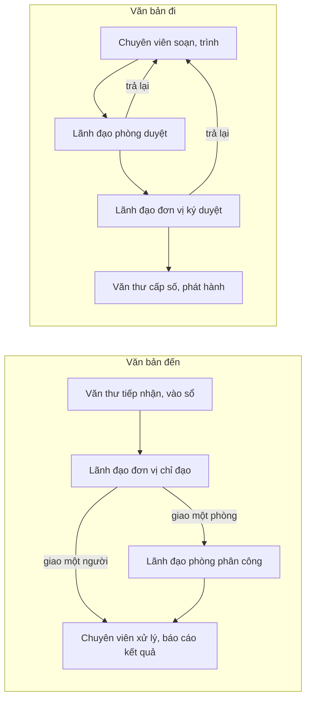

# Hướng dẫn sử dụng

Hướng dẫn từng bước cho người dùng Văn phòng điện tử và các ứng dụng chạy trên lõi Signet, mỗi vai trò một trang.
Trang chỉ ghi việc làm hằng ngày: vào mục nào, bấm nút nào. Phần giải thích cách hệ thống chạy nằm ở tài liệu gốc,
trang này trỏ tới chứ không chép lại. Gặp từ chưa rõ như vào sổ, nộp lưu, văn bản hạn chế, liên thông thì tra
[Thuật ngữ](../thuat-ngu.md).

## Chọn trang theo vai trò

| Vai trò | Tài khoản mẫu | Việc chính | Trang |
|---|---|---|---|
| Văn thư | `vanthu` | Tiếp nhận, vào sổ văn bản đến; cấp số, phát hành văn bản đi; sổ đăng ký | [Văn thư](van-thu.md) |
| Chuyên viên | `chuyenviendt`, `giamkhao`, `giangvienktpm` | Xử lý văn bản được giao; soạn, trình dự thảo; lập hồ sơ | [Chuyên viên](chuyen-vien.md) |
| Lãnh đạo phòng | `totruongdt`, `truongbmktpm` | Phân công trong phòng; duyệt dự thảo; nộp lưu hồ sơ; duyệt đơn nghỉ phép | [Lãnh đạo phòng](lanh-dao-phong.md) |
| Lãnh đạo đơn vị | `truongkhoa` | Chỉ đạo, giao việc; ký duyệt văn bản đi; theo dõi số liệu của đơn vị | [Lãnh đạo đơn vị](lanh-dao-don-vi.md) |
| Quản trị đơn vị | `quantri` | Sổ kiểm toán, danh mục ứng dụng, tổng hợp góp ý; không đọc nội dung văn bản | [Quản trị đơn vị](quan-tri.md) |

Việc mọi vai trò đều làm (hộp việc, thông báo, tìm kiếm, hỏi đáp, không gian cá nhân, góp ý, đổi ngôn ngữ):
[Việc chung](viec-chung.md).

Các tài khoản mẫu ở trên thuộc Khoa CNTT. `vanthukt` (văn thư) và `truongkhoakt` (lãnh đạo) thuộc Khoa Kinh tế, dùng để
thử tách đơn vị: mỗi bên chỉ thấy văn bản của khoa mình. Mật khẩu: bản online gửi kèm hồ sơ dự thi; bản tự cài xem
[README](../../README.md#chạy-thử), mục Chạy thử.

## Đăng nhập

1. Mở địa chỉ Signet của đơn vị: bản online [signet.htechcs.com](https://signet.htechcs.com), bản tự cài
   `http://localhost:8080`.
2. Nhập tên đăng nhập và mật khẩu ở trang đăng nhập.
3. Văn thư, lãnh đạo phòng, lãnh đạo đơn vị và quản trị đơn vị phải xác thực hai bước: nhập tiếp mã 6 số trong ứng
   dụng xác thực trên điện thoại (FreeOTP, Aegis, Google Authenticator). Lần đăng nhập đầu, quét mã QR trên màn hình
   để thêm tài khoản vào ứng dụng đó. Tài khoản mẫu của bản tự cài lấy mã bằng `make totp`.
4. Vào được thì thanh bên trái là menu, mỗi vai trò thấy một bộ mục khác nhau. Cuối thanh bên có tên, vai trò của bạn
   và nút **Đăng xuất**. Thanh trên cùng có nút **Góp ý**, chuông thông báo và nút đổi ngôn ngữ **EN** / **VI**.

Mã bị từ chối thường do đồng hồ điện thoại lệch: bật giờ tự động. Sai 10 lần thì tài khoản bị tạm khóa.

## Một văn bản đi qua những ai

Mỗi bước dưới đây là một việc trong **Hộp việc** của người phải làm, kèm một thông báo.

Lãnh đạo đơn vị có thể lưu một văn bản đến mà không giao xử lý. Lãnh đạo phòng có thể tự xử lý thay vì giao cho người
khác. Quy trình đầy đủ: [`dac-ta-san-pham.md`](../dac-ta-san-pham.md) mục 3 (vai trò) và mục 4 (chức năng).

Một số mục mới có trong mã nguồn trước khi lên bản online. Danh sách nằm ở mục "Chưa phát hành" của
[`CHANGELOG.md`](../../CHANGELOG.md).
