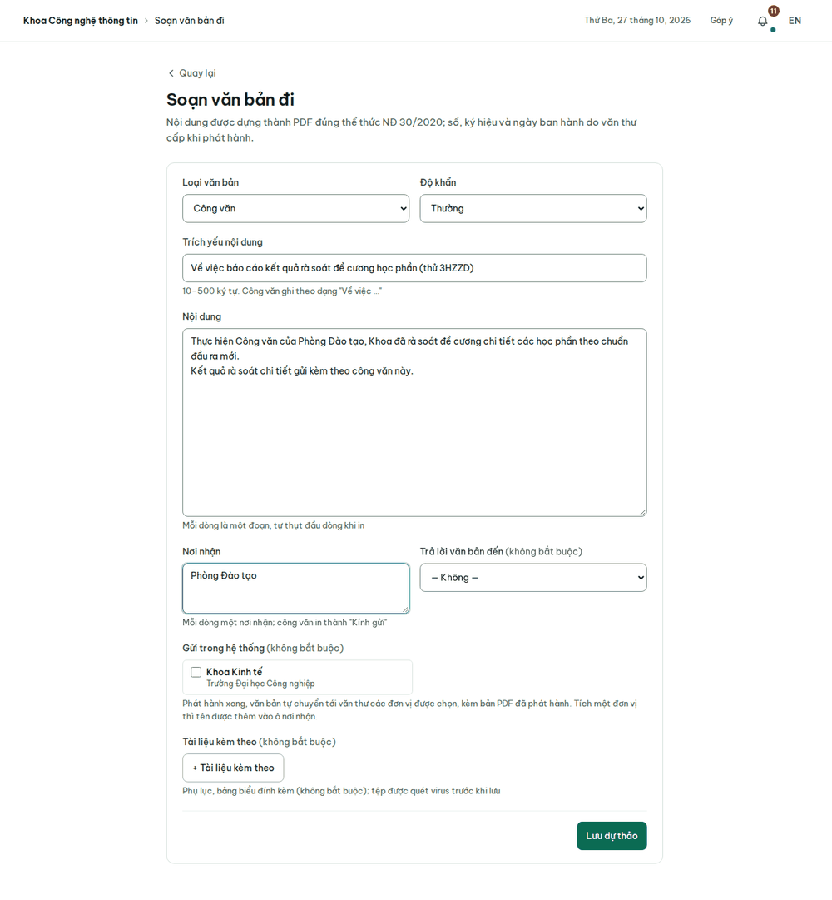
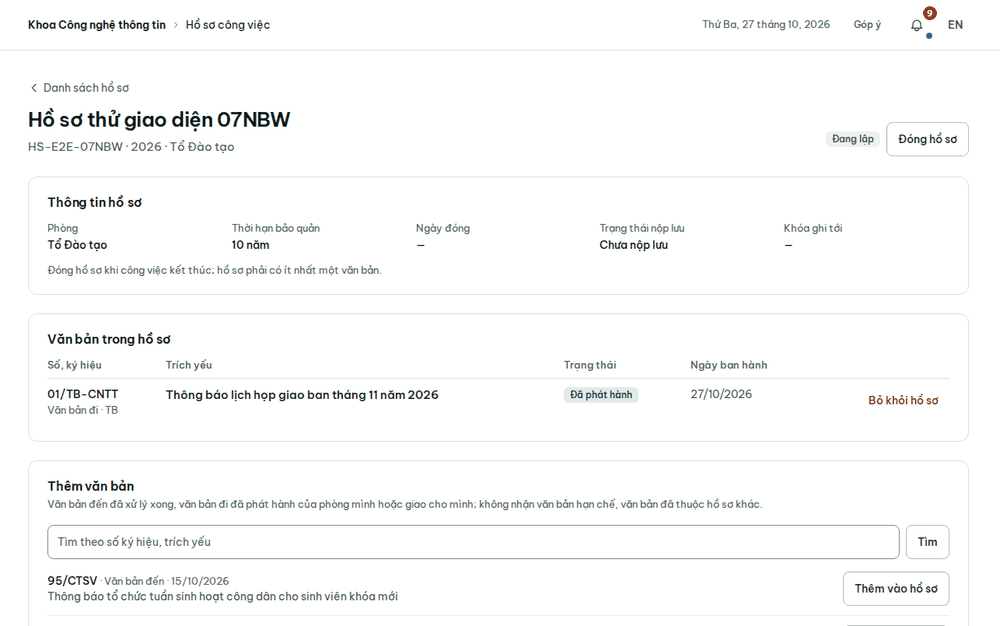

# Hướng dẫn cho chuyên viên

Vai trò `staff`. Tài khoản mẫu: `chuyenviendt`, `giamkhao`, `giangvienktpm`. Đăng nhập không cần xác thực hai bước.
Chuyên viên thấy văn bản được giao cho mình, văn bản mình soạn và mọi văn bản đi của phòng mình; trợ lý Hỏi đáp tìm
trong đúng phạm vi đó. Văn bản hạn chế thì chỉ thấy khi mình tạo hoặc được cấp quyền xem. Với dữ liệu mẫu, Hộp việc
của `giamkhao` có sẵn một công văn khẩn chờ xử lý và một dự thảo bị tổ trưởng trả lại chờ sửa.

Menu gồm: Hộp việc, Văn bản đến, Văn bản đi, Soạn văn bản đi, Hồ sơ công việc, Sơ đồ cảm biến, Tìm kiếm, Hỏi đáp, Ứng
dụng, Góp ý. Phần dùng chung: [Việc chung](viec-chung.md).

## Xử lý văn bản được giao

1. Trong Hộp việc, mở việc **Xử lý văn bản**.
2. Đọc khung **Yêu cầu được giao**: nội dung được giao, người giao và hạn giải quyết. Bấm **Tải về** ở mục Tệp đính kèm
   để đọc văn bản.
3. Nếu cần trả lời bằng văn bản, soạn văn bản đi (mục dưới) và chọn văn bản đến này ở ô **Trả lời văn bản đến**.
4. Ghi **Kết quả xử lý** (bắt buộc), rồi bấm **Báo cáo xong**. Phần việc được giao cho bạn sẽ hoàn thành.

## Soạn và trình văn bản đi

1. Bấm **Soạn văn bản đi** trên menu, hoặc **Soạn mới** trên Hộp việc.
2. Điền **Loại văn bản**, **Trích yếu nội dung** (công văn ghi theo dạng "Về việc …"), **Nội dung** (mỗi dòng là một
   đoạn), **Nơi nhận** (mỗi dòng một nơi) và **Độ khẩn**. **Ngôn ngữ của văn bản** để Tiếng Việt; chọn Tiếng Anh
   thì quốc hiệu, số, ngày, nơi nhận, khối xác thực in bằng tiếng Anh, phần bạn gõ giữ nguyên.
3. Các ô không bắt buộc: **Trả lời văn bản đến**, **Tài liệu kèm theo** (được quét virus trước khi lưu), **Gửi trong
   hệ thống**. Ở ô cuối, tích những đơn vị cũng dùng Signet: văn bản phát hành xong sẽ tự chuyển tới văn thư của họ.
4. Bấm **Lưu dự thảo**. Nếu lỡ tải lại trang khi chưa lưu, phần đang soạn dở được khôi phục.
5. Trên trang dự thảo, bấm **Tải bản xem trước (PDF)**. Bản PDF được dựng đúng thể thức Nghị định 30/2020. Số, ký hiệu
   và ngày ban hành do văn thư cấp khi phát hành.
6. Chọn người ký ở ô **Lãnh đạo đơn vị ký**, rồi bấm **Trình ký**. Dự thảo đi qua lãnh đạo phòng duyệt trước, sau đó
   tới người ký.

Theo dõi dự thảo ở mục **Văn bản đi**, qua các tab Dự thảo, Đang trình, Đã phát hành, Tất cả.

## Sửa dự thảo bị trả lại

1. Trong Hộp việc, mở việc **Sửa dự thảo theo ý kiến**. Trang văn bản ghi lý do bị trả lại.
2. Bấm **Sửa dự thảo**, sửa theo ý kiến rồi bấm **Lưu dự thảo**.
3. Bấm **Trình lại**. Dự thảo lại đi qua lãnh đạo phòng, rồi tới người ký.

## Hồ sơ công việc

Hồ sơ gom các văn bản của một việc, theo Nghị định 30/2020, Điều 28–31. Chuyên viên và lãnh đạo phòng lập hồ sơ cho
phòng mình.

1. Mở **Hồ sơ công việc**, bấm **Lập hồ sơ**. Điền **Ký hiệu hồ sơ** theo danh mục hồ sơ của đơn vị (ví dụ `01.TS`),
   **Năm**, **Tiêu đề hồ sơ** (5–500 ký tự) và **Thời hạn bảo quản**. Bấm **Lập hồ sơ** để lưu.
2. Mở hồ sơ vừa lập, gõ số ký hiệu hoặc trích yếu để tìm văn bản, rồi bấm **Thêm vào hồ sơ**. Chỉ thêm được văn bản đến
   đã xử lý xong và văn bản đi đã phát hành, của phòng mình hoặc giao cho mình. Không thêm được văn bản hạn chế, hay
   văn bản đã thuộc hồ sơ khác. Muốn bỏ một văn bản thì bấm **Bỏ khỏi hồ sơ**.
3. Khi công việc kết thúc, bấm **Đóng hồ sơ**. Hồ sơ phải có ít nhất một văn bản. Sau khi đóng, hồ sơ không thêm hay
   bỏ văn bản được nữa.

Lãnh đạo phòng là người nộp lưu hồ sơ đã đóng ([Lãnh đạo phòng](lanh-dao-phong.md#nộp-lưu-hồ-sơ)). Hồ sơ đã nộp lưu
chỉ mở được ở chế độ xem, gọi là **Phòng đọc**. Mỗi trang PDF trong Phòng đọc có dấu tên bạn và giờ xem, và mỗi lần
mở đều ghi vào sổ kiểm toán.
