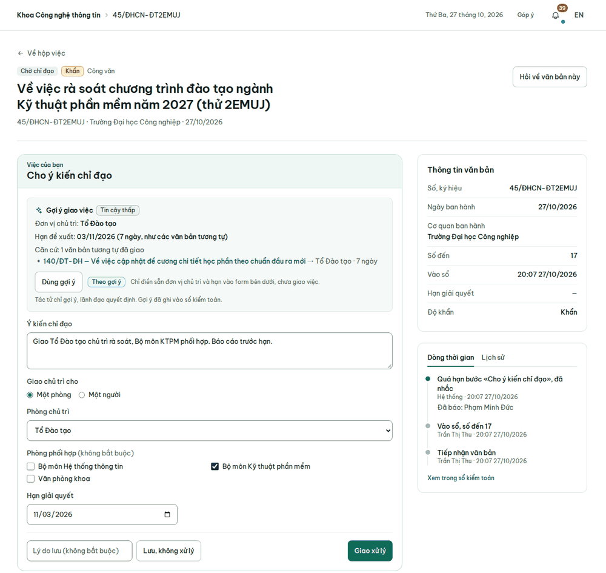
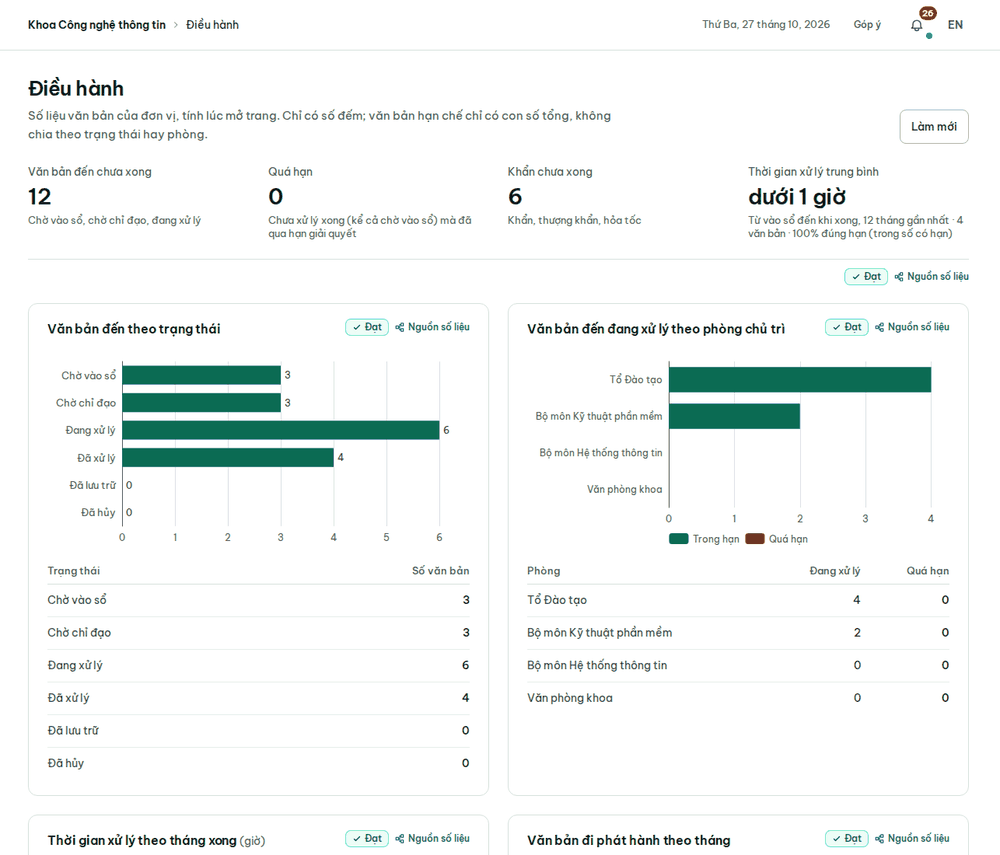
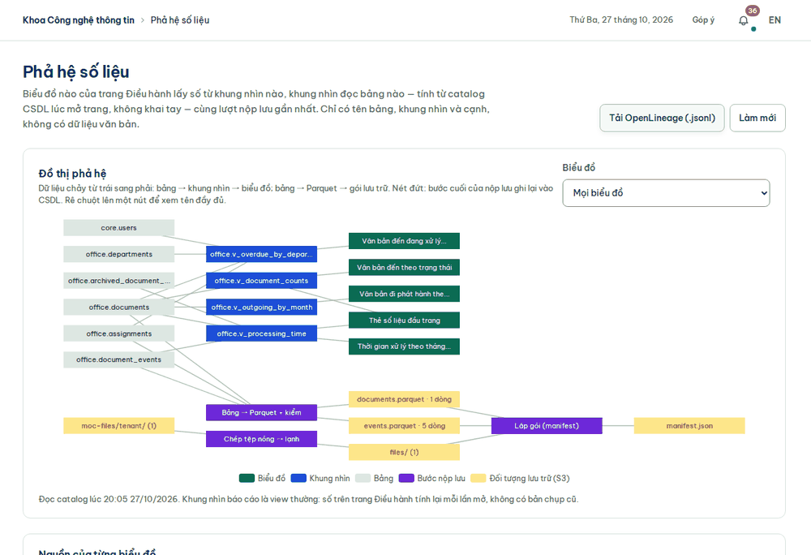
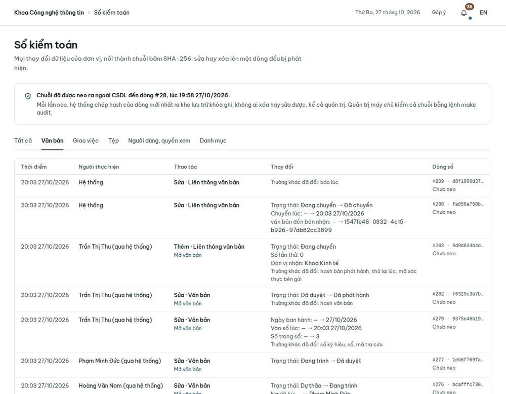

# Hướng dẫn cho lãnh đạo đơn vị

Vai trò `director`: thủ trưởng, cấp phó của đơn vị. Tài khoản mẫu: `truongkhoa` (Khoa CNTT), `truongkhoakt` (Khoa Kinh
tế). Đăng nhập cần mã xác thực hai bước. Lãnh đạo đơn vị thấy mọi văn bản của đơn vị mình, trừ văn bản hạn chế mà
mình không tạo và không được cấp quyền xem.

Menu gồm: Hộp việc, Văn bản đến, Văn bản đi, Sổ đăng ký, Hồ sơ công việc (chỉ xem), Sơ đồ cảm biến, Tìm kiếm, Hỏi đáp,
Điều hành, Số đo, Phả hệ số liệu, Tự chẩn đoán, Sổ kiểm toán, Ứng dụng, Góp ý. Phần dùng chung:
[Việc chung](viec-chung.md).

## Chỉ đạo văn bản đến

Việc **Cho ý kiến chỉ đạo** đến Hộp việc mỗi khi văn thư vào sổ một văn bản đến.

1. Mở việc và đọc văn bản.
2. Nếu đơn vị bật tác tử gợi ý, khung **Gợi ý giao việc** cho biết đơn vị chủ trì, hạn đề xuất và số văn bản tương tự
   đã giao làm căn cứ. Bấm **Dùng gợi ý** để điền sẵn đơn vị và hạn vào form bên dưới. Bấm nút này chưa giao việc: tác
   tử chỉ gợi ý, bạn quyết định. Mỗi gợi ý đều ghi vào sổ kiểm toán.
3. Ghi **Ý kiến chỉ đạo**.
4. Ở mục **Giao chủ trì cho**, chọn **Một phòng** rồi chọn **Phòng chủ trì**, hoặc chọn **Một người** rồi chọn **Người
   chủ trì**. Chọn thêm **Phòng phối hợp** nếu cần, và đặt **Hạn giải quyết**.
5. Bấm **Giao xử lý**. Nếu giao một phòng, lãnh đạo phòng đó nhận việc phân công. Nếu giao một người, người đó nhận
   thẳng việc xử lý.

Văn bản chỉ để biết, không cần ai xử lý: ghi lý do (không bắt buộc) rồi bấm **Lưu, không xử lý**.

Cách tác tử tìm gợi ý: [`demo-script.md`](../demo-script.md), mục "gợi ý giao việc".

## Ký duyệt văn bản đi

Việc **Duyệt và ký văn bản** đến Hộp việc sau khi lãnh đạo phòng đồng ý một dự thảo và trình bạn ký.

1. Mở việc, bấm **Xem bản PDF trước khi duyệt**.
2. Nếu đồng ý, bấm **Ký duyệt**. Văn bản chuyển tới văn thư để cấp số và phát hành.
3. Nếu chưa đồng ý, ghi vào ô **Ý kiến** lý do và chỗ cần sửa, rồi bấm **Trả lại**. Dự thảo về người soạn, sửa xong lại
   qua lãnh đạo phòng trước khi tới bạn.

## Văn bản hạn chế

Lãnh đạo đơn vị cấp và gỡ quyền xem văn bản hạn chế giống văn thư: trên trang văn bản, ở khung **Người được xem**, chọn
người rồi bấm **Cấp quyền xem**, hoặc bấm **Gỡ** để thu lại ([Văn thư](van-thu.md#tiếp-nhận-văn-bản-hạn-chế)).

## Theo dõi đơn vị

- **Điều hành**: số liệu văn bản của đơn vị, tính lúc mở trang. Gồm văn bản đến chưa xong, quá hạn, khẩn chưa xong,
  thời gian xử lý trung bình, văn bản đến theo trạng thái và theo phòng chủ trì, văn bản đi phát hành theo tháng, văn
  bản đã nộp lưu trong kho lạnh. Văn bản hạn chế chỉ được tính vào con số tổng. Các thẻ số đầu trang và bốn biểu đồ
  có liên kết **Nguồn số liệu** dẫn sang trang Phả hệ số liệu; phần văn bản đã nộp lưu thì không có.

  
- **Phả hệ số liệu**: cho biết mỗi biểu đồ của trang Điều hành lấy số từ khung nhìn nào, khung nhìn đó đọc bảng nào,
  kèm kết quả kiểm chất lượng của lượt nộp lưu gần nhất. Bấm **Tải OpenLineage (.jsonl)** để tải về. Chi tiết:
  [`demo-script.md`](../demo-script.md), mục "Phả hệ và kiểm chất lượng".

  
- **Số đo**: bốn chỉ số trước và sau khi dùng hệ thống, theo [`dac-ta-san-pham.md`](../dac-ta-san-pham.md) mục 8,
  kèm điểm góp ý trung bình của người dùng. Cách đo từng chỉ số: [`so-lieu-sau.md`](../so-lieu-sau.md).
- **Tự chẩn đoán**: trả lời bộ câu về mức trưởng thành số theo bốn không gian Con người, Quy trình, Dữ liệu, Trí tuệ,
  đối chiếu với bằng chứng đo được của đơn vị, rồi bấm **Lưu kết quả**. Mỗi lần lưu thành một dòng lịch sử để so tiến
  bộ, không sửa hay xóa được. Bộ câu và cách chấm: [`tu-chan-doan.md`](../tu-chan-doan.md).
- **Sổ kiểm toán**: mọi thay đổi dữ liệu của đơn vị, nối thành chuỗi băm SHA-256, nên sửa hay xóa lén một dòng đều bị
  phát hiện. Trên trang văn bản, bấm **Xem trong sổ kiểm toán** để xem các dòng của riêng văn bản đó. Trong sổ, bấm
  **Mở văn bản** để quay lại văn bản.

  
- **Sổ đăng ký**: xem và in giống văn thư ([Sổ đăng ký](van-thu.md#sổ-đăng-ký)).
- **Góp ý**: ngoài góp ý của mình, lãnh đạo đơn vị thấy phần **Tổng hợp của đơn vị**, không hiện tên người gửi.
